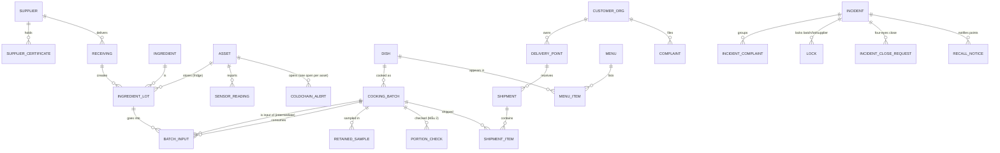

<!--
SPDX-FileCopyrightText: The metrace Authors
SPDX-License-Identifier: Apache-2.0
-->

# Domain model

The **cooking batch** is the centre of the model. Everything that matters in an
incident is one hop away from a batch: which ingredient lots (and intermediate
batches such as broth) went in, and which shipments took it to which delivery
points.

## Entities

| Table | Purpose |
|---|---|
| `receiving` | Goods receipt record (Mẫu 1): supplier, documents, sensory check, decision |
| `ingredient_lot` | One lot of one ingredient from one receiving; may sit in a fridge (`storage_asset_id`) |
| `cooking_batch` | Mẫu 2: dish, service date/meal, start/finish, core temperature, owner, portions |
| `batch_input` | Lot **or** another batch (intermediate, e.g. broth) that went into a batch (CHECK: exactly one) |
| `portion_check` | Mẫu 3: portions, menu match, sensory check before serving |
| `retained_sample` | Sealed sample; `eligible_discard_at = max(stored_at, meal_end_at) + 24 h` |
| `shipment`, `shipment_item` | Delivery of batches to a delivery point; status `planned → ready → (held) → dispatched → delivered` |
| `complaint` | Customer complaint; `sla_due_at` from the customer profile, `sla_breached` set by the P6 sweep |
| `incident`, `incident_complaint` | Incident and the complaints it groups. `status`: `open` → `contained` → `closed`; `suspects` (JSON); `escalated` (director pulled in) |
| `incident` report columns | `report_draft` (AI or template, with `report_model` and `report_prompt_sha256`), `report_final` (QA's text), `report_approved_by`, `report_approved_at` |
| `lock` | Active lock per incident on a batch, lot or supplier. A node is locked while **any** incident holds an active lock on it |
| `incident_close_request` | Four-eyes close: `pending` → `approved` or `rejected` |
| `recall_notice` | One notice per delivery point, carrying the audit anchor |
| `sensor_reading` | Temperature per asset. `ts` is the device clock; `received_at` (server) orders the breach check |
| `coldchain_alert` | One open alert per asset (`status`: `open` → `acknowledged`), its Flowable process id, acknowledger and note |
| `rule_threshold` | Poka-yoke thresholds with their basis (`law`, `guidance`, `field`, `internal`); no write API |
| `poka_yoke_event` | Every blocked action, for audit and KPIs |

Platform tables (Tier 1 building blocks): `audit_event` (hash chain),
`outbox_event`, `file_object`.

`kitchen_id` is present on lots, batches, assets, menus and shipments from the
start, so a second kitchen is configuration, not a migration.

## Lineage

`lineage_edge` is a **view** over existing foreign keys (no separate edge table
that could drift):

| From | To | Source |
|---|---|---|
| supplier | lot | `ingredient_lot.supplier_id` |
| asset | lot | `ingredient_lot.storage_asset_id` |
| lot | batch | `batch_input.lot_id` |
| batch | batch | `batch_input.input_batch_id` |
| batch | shipment | `shipment_item` |
| shipment | delivery point | `shipment.delivery_point_id` |

`GET /api/v1/lineage/{node_type}/{ref}?direction=forward|backward|both` walks it with
a recursive CTE (cycle guard, depth cap 12, node cap 300). When a cap cuts the
walk the response says `truncated: true`, and any write based on the walk
(locks, dispatch guards) must refuse to proceed.

Writers (locks, recall notices, the incident view, the recall drill) walk with
no node cap: the SQL returns every reachable node anyway, so the node cap only
limits what a screen draws. Only a chain deeper than 12 levels can cut their
walk. A lock then fails closed: it holds every open truck dated today or later,
not only the ones it saw, and the lock result says `truncated: true`. Recall
notices cover deliveries from `RECALL_WINDOW_DAYS` service days before the
incident opened, so a notice never shrinks on a later day. A notice asks to be
acknowledged again only when what the customer must do changes (another truck,
other food, hold vs recall), not when a truck merely moves from dispatched to
delivered.

## Mapping to the DX-OS Tier 3 vocabulary

| Tier 3 concept | metrace |
|---|---|
| Customers | `customer_org` (Keycloak organization alias) + `delivery_point` |
| Goods | `ingredient`, `ingredient_lot`, `dish`, `cooking_batch` (central), `shipment` |
| Assets | `kitchen`, `asset` (fridges, freezers, trucks, thermometers) |
| Projects | Not modelled: one catering company serving long-running customer contracts |

## Demo data

`python -m app.seed --scenario baseline` (run by the `seed` one-shot) loads
`services/api/app/seed/master-data.yaml` and creates two service days relative
to now: yesterday fully delivered, today's lunch cooked and ready to dispatch.
The bones lot behind the broth and the rice lot are shared by both days, so
one lot links two days of meals at every delivery point. All names are
fictional and tagged DEMO.
